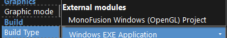
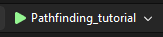
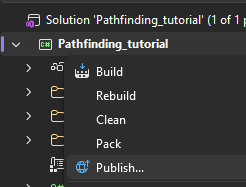
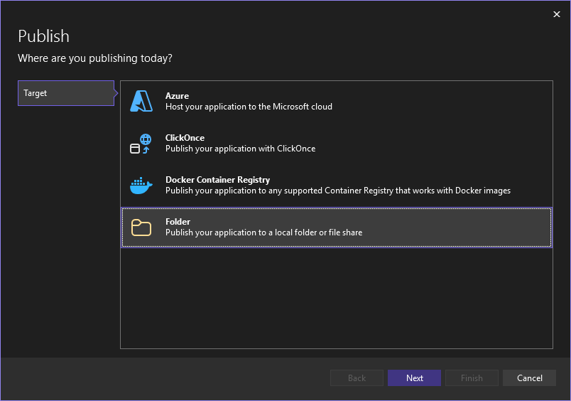
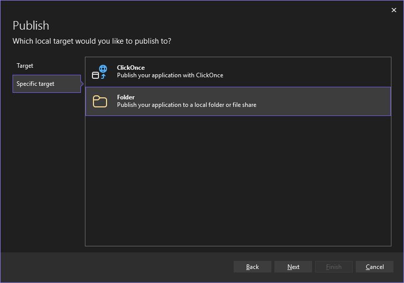
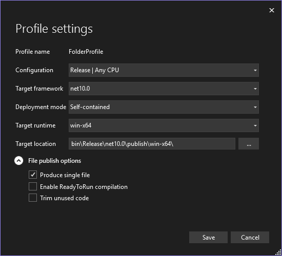

# MonoFusion Runtime for Clickteam Fusion 2.5
[](https://discord.gg/aY2WFGPBBB)<br/>
MonoFusion is an experimental, unfinished, updated port of the [Clickteam Fusion 2.5](https://store.steampowered.com/app/248170/Clickteam_Fusion_25/) XNA runtime to use [MonoGame](https://monogame.net/).<br/>
Please note that despite the name, Mono is not used for MonoFusion or MonoGame.

## Download
MonoFusion is in EARLY beta, not all ACEs are implemented, and bugs/crashes are to be expected. Regardless ***ALL*** issues, including unimplemented ACEs that you'd like me to prioritize adding, should be reported as [issues](https://github.com/MonoFusionRuntime/.github/issues).

You can find a installer download [here](https://github.com/MonoFusionRuntime/.github/releases/latest).

## Usage
You can easily get started with MonoFusion by running the installer. Point it at your Clickteam folder, if it isn't already.

Upon opening a project file Clickteam Fusion 2.5, a Command Prompt will appear, this indicates that MonoFusion is working. This window will show debug information, and any crash logs. You can find MonoFusion at the bottom of your list of build types.



Currently the exporter will not compile for you, as I haven't tested it in a while, You can export a Visual Studio project however. This requires [Visual Studio 2026](https://visualstudio.microsoft.com/) with the '.NET desktop development' component selected in the installer.

Open the exported project's `.slnx` file in Visual Studio. From here you can run the game in debug mode to ensure no crashes by clicking the solid green arrow at the top of Visual Studio.



Once you verify that everything looks good, you can start publishing your game as a file distributable. To do this, right click your C# Project in the Solution Explorer, and navigate to Publish



Select Folder as your Target





Click Next, define your output folder, then click Finish and Close.

Click "Show all settings" and use these recommended settings, or a variation of them.



Go to your output folder, and delete the .pdb file before distributing, and that's it! You'll notice that the file size is considerably larger, I can't do much about that, .NET itself is pretty large, and with MonoGame on top of it, it adds around 60-80mb of overhead. But this shouldn't be an issue in the modern day.

## Targets
This runtime currently targets the following platforms;
- Windows (x64, x86, ARM, ARM64)
    - OpenGL
    - DirectX 10
- MacOS (x64, ARM64)
    - OpenGL
- Linux (x64, ARM, ARM64)
    - OpenGL
- Android (x64, x86, ARM, ARM64)
    - OpenGL

Only the Windows OpenGL runtime is public at the current moment.

## Supported Extensions
- Advanced Comment Object
- Animation Info Object
- ASCII
- ASCII Character Object
- Behind The Runtime
- Bitwise Helper Object
- Bitwiser Object
- Commentor Object
- Crasher
- DeltaX
- Easing Object
- FMod Object
- Function Eggtimer
- Gamejolt API
- Integer Split
- Date & Time
- Ini Object
- Randomizer Object
- Runtime Object
- Layer Object
- Microtimer
- Movement Timer Base
- Movement Timer Control
- Path Control
- Pathfinding Object
- Perspective Object
- POW 2o3
- Seconds to HMS
- Store Float Object
- String Repeater
- String Tokenizer
- Substring Replace Unicode
- Wizard Timon
- XBOX Gamepad

## Shaders
Shaders are fully supported by MonoFusion, and has an automatic shader converter that will ***attempt*** to convert DX9 .fx shaders into a MonoFusion shader. This is prone to failure however, so anytime a shader is converted, a .fxmg file will be created in your `Clickteam/Effects` folder, which you can modify, and will be used by MonoFusion the next time it's used.

### Shader Spec
MonoGame at the current time uses a, kinda broken HLSL shader system. But may use something else in the future, but for now it uses HLSL PS 3.0 as it's standard.

On the topic of broken, shader samples are not ordered properly, so you must order them by *using* them in the shader code, in that order. This is done by having a `MONOFUSION_SAMPLE_ORDERER`, and inside of `ps_main`, reference every sample using a comparison to that value.

You should also add placeholder samplers for any unused/skipped sample ids.

```hlsl
int MONOFUSION_SAMPLE_ORDERER;

float4 ps_main()
{
    if (MONOFUSION_SAMPLE_ORDERER == 1)
        return tex2D(sampler1, texCoord);

    if (MONOFUSION_SAMPLE_ORDERER == 2)
        return tex2D(sampler2, texCoord);
}
```

The ps_main function, must also have specific parameters, although the names of the function and it's parameters can be whatever.

```hlsl
float4 ps_main(
    float4 position : SV_Position,
    float4 color : COLOR0,
    float2 texCoord : TEXCOORD0
) : COLOR
```

Any texture samplers that are not the base image, such as background and image parameter, must have a corresponding Texture2D, and that must be referenced by the sampler.

All texture samplers must be defined as `sampler` instead of `sampler2D`.

```hlsl
Texture2D MONOFUSION_samplerName;
sampler samplerName = sampler_state
{
    Texture = <MONOFUSION_samplerName>;
}; 
```

Similar to DirectX 11 shaders in the Clickteam Fusion 2.5 Windows Runtime, the color of the RGB Coefficient, must be applied by the shader, it is not passed into the shader already modified. It is recommended to always multiply the output of `tex2D` with the color parameter passed into ps_main, when the sampler used is the base image.

The current Shader Converter has a bug which will wrap all returns with `(value) * color`, you should remove this!

```hlsl
return tex2D(sampler1, texCoord) * color;
```

Again, similar to DirectX 11 shaders, shaders are expected to return a premultiplied result. You can do this by multiplying the final color by it's own alpha.

```hlsl
float4 ps_main()
{
    float4 output = float4(1, 1, 1, 0.5);
    output.rgb *= output.a; // Premultiply the output
    return output;
}
```

Different platform targets could take different PixelShader versions, it is recommended that the PixelShader version is set to MONOFUSION_PS, which the exporter will automatically replace with the expected PixelShader version. This system may change in the future.

```hlsl
technique ShaderName
{
    pass p0
    {
        PixelShader = compile MONOFUSION_PS ps_main();
    }
}
```

# Development
If you'd like to port an extension, please follow [this guide](../EXTENSION-DEV.md).

If you'd like to submit it to my repositories, please ping me in the Discord!


# Credits
- [Yunivers](https://github.com/AITYunivers)
    - Creator of MonoFusion
- [Clickteam](https://www.clickteam.com/)
    - Creator of Clickteam Fusion 2.5, the Custom Exporter APIs used by MonoFusion, and the original XNA runtime.
- [Rhadamus](https://github.com/Rhadamus)
    - Working on the unfinished Sound Engine rewrite, for better compatibility
- [NaitorStudios](https://github.com/NaitorStudios)
    - General assistance, advice, motivation.
    
## Extension Porters
- [Yunivers](https://github.com/AITYunivers)
    - Animation Info Object
    - DeltaX
    - Easing Object
    - Function Eggtimer
    - Gamejolt API
    - Date & Time
    - Ini Object
    - Layer Object
    - Movement Timer Control
    - Path Control
    - Pathfinding Object
    - Perspective Object
    - String Tokenizer
    - XBOX Gamepad
- [RainbowHype](https://github.com/RainbowHype123)
    - Advanced Comment Object
    - ASCII
    - ASCII Character Object
    - Behind The Runtime
    - Bitwise Helper Object
    - Bitwiser Object
    - Commentor Object
    - Crasher
    - FMod Object
    - Integer Split
    - Runtime Object
    - Microtimer
    - Movement Timer Base
    - POW 2o3
    - Seconds to HMS
    - Store Float Object
    - String Repeater
    - Substring Replace Unicode
    - Wizard Timon
- [Kostya](https://github.com/1987kostya)
    - Randomizer Object

# Cliff Notes
MonoFusion is just something I work on spontaniously, idk if it'll ever be ready for production, idk if I'll ever make it open source, it just kinda exists. It also just has a lot of issues, and lacks a lot of common extensions. I currently have Ini++, String Parser, and Bluewing Client in the works, but idk when I'll make the next release, or if it'll be anytime soon, lol. Currently 436/698 ACEs are supported, that's 128 actions, 49 conditions, and 85 expressions that are unsupported atm, most of which are just related to the Formatted Text object, but excluding those it's 93 actions, 49 conditions, and 53 expressions. Nothing related to sounds is supported at the moment as the sound bank is being rewritten, but anything basic should work fine. MonoGame is coming out with some [pretty cool things](https://docs.monogame.net/roadmap/) soon, including a web target, a unified shader language using slang, better font support, and video support. These will all definitely change MonoFusion, and also there's the new Vulkan and DirectX 12 platforms that I have yet to implement, and the new Content Builder system. I also wanna redo the entire font renderer to stop using MonoGame entirely, and start using [FontStashSharp](https://github.com/FontStashSharp/FontStashSharp). So yeah, lots a plans. Thanks for reading.